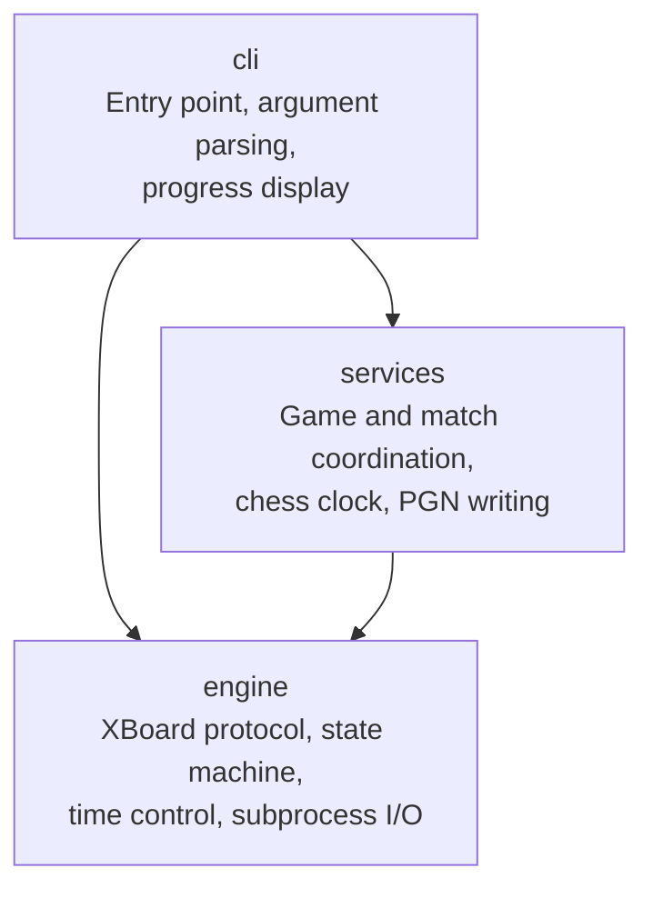
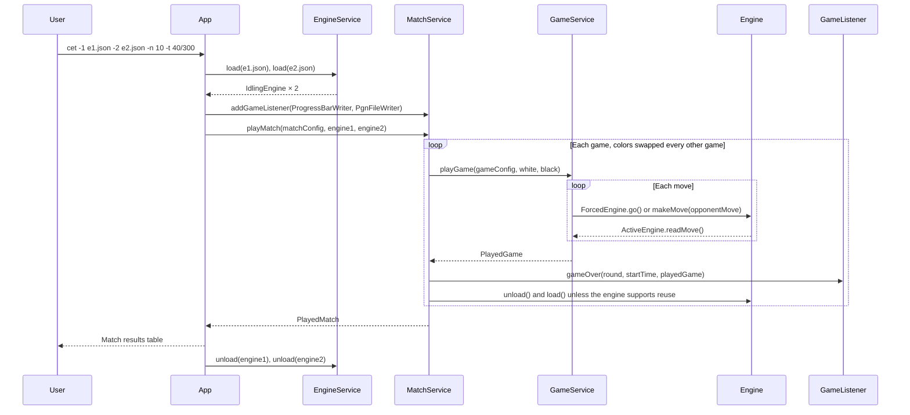

# Architecture overview

chess-engine-tester runs automated matches between chess engines that use the [XBoard protocol](https://www.gnu.org/software/xboard/engine-intf.html). It handles time control, move validation, PGN output, and match results.

## Modules

The project is a multi-module Maven build. The allowed dependencies between modules are rules, listed in [development.md](development.md).

| Module | Responsibility |
|--------|----------------|
| `engine` | Engine lifecycle state machine, XBoard protocol communication, time control definitions |
| `services` | Single games and multi-game matches, chess clock, PGN file output |
| `cli` | Argument parsing with Picocli, wiring of all services, display of progress and results |

## Application flow

`App` loads the engines and registers the game listeners. Then it calls `MatchService` once. For `-n 1`, `App` calls `playSingleGameMatch`, or `playSingleGameMatchWithExtraEngine` when a third engine is given. For more games, `App` calls `playMatch`.

`MatchServiceImpl.playMatch` plays the games in pairs and swaps colors between the two games of a pair. After each game it notifies every `GameListener`. If an engine does not report the XBoard feature `reuse`, `MatchServiceImpl` unloads and loads that engine again before the next game.

## Details

- Engine lifecycle: [../system/engine-state-machine.md](../system/engine-state-machine.md)
- Chess clock: [../system/chess-clock.md](../system/chess-clock.md)
- Key types: [../system/domain-model.md](../system/domain-model.md)
- Third engine: [../system/third-engine.md](../system/third-engine.md)
