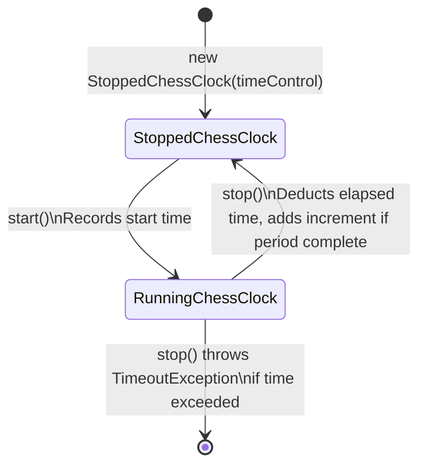

# Chess clock

The `services` module models the chess clock in `services/time/` as two states. This makes the elapsed-time accounting explicit and hard to misuse. `StoppedChessClock` and `RunningChessClock` are classes that extend `AbstractChessClock` and implement `ChessClock`. Each transition returns a new clock object.

## What `stop()` does

1. It subtracts the elapsed time from the time left.
2. If the time left is below zero, it throws `TimeoutException`.
3. If `moveNumber % movesInOnePeriod == 0`, it adds `incrementInMillis()` from the `TimeControl`.
