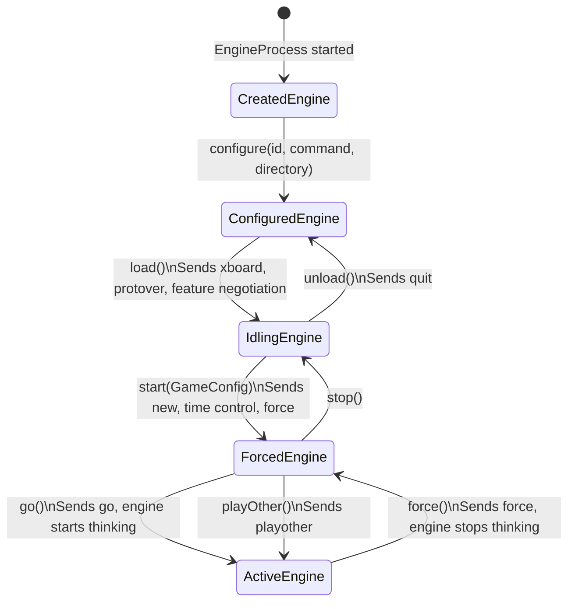

# Engine state machine

The `engine` module manages each chess engine subprocess through an explicit state machine in `engine/state/`. Each state is an immutable record that implements `Engine`. Each transition returns a new instance of the next state. This makes an invalid operation a compile-time error instead of a runtime surprise.

## States

| State | What it does |
|-------|--------------|
| `CreatedEngine` | Wraps a newly started `EngineProcess`. No protocol handshake yet. |
| `ConfiguredEngine` | Knows which command to run and in which directory. `load()` negotiates the XBoard features. |
| `IdlingEngine` | Fully set up and idle, ready to start a game. Exposes `myName()` and the negotiated `features()`. |
| `ForcedEngine` | In a game but not thinking. `makeMove()` feeds a move, `postTime()` sends the clocks, and `postResult()` sends the result. `takeBack()` sends `remove`, and `clear()` discards unread engine output. |
| `ActiveEngine` | Thinking. `readMove()` waits for the engine's move. It also has `makeMove()`, `makeAndReadMove()`, `postTime()` and `postResult()`. |

`EngineProcess` hides the subprocess I/O. Unit tests mock it, so they need no real engine.
